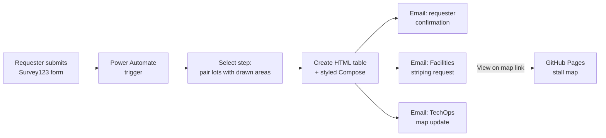

# Parking Stall Striping Map

An automated workflow that turns a parking allocation change request into a striping work order with a precise, clickable map of every stall that needs to be repainted. Built for UC San Diego Transportation Services.

**Live demo:** [open a sample stall](https://dshonuyi.github.io/parking-stall-striping-map/#POLYGON((-117.25379027008225%2032.86401228144671,-117.25372118224539%2032.86400802636215,-117.25373224635756%2032.86390815282436,-117.25378463849104%2032.86390815282436,-117.25379027008225%2032.86401228144671)))

---

## The problem

When a parking space allocation changes (for example, a standard stall becomes an accessible or reserved stall), the Facilities team has to re-stripe it. Requests came in through a form, and Facilities had no reliable way to see exactly which stalls were affected:

- Facilities staff don't have ArcGIS accounts, so they can't open the GIS layer where requesters draw the stalls.
- A single map pin shows a point, not the outline of the stalls to paint.
- Free map viewers that accept shapes in a link only offered a street basemap, and crews need satellite imagery to see the existing paint lines.

## The solution

1. **Survey123 form:** the requester picks the parking lot, enters how many stalls are changing, and draws each affected area on a map.
2. **Power Automate flow:** triggered on each submission, it pairs each lot entry with its drawn area, then builds a formatted HTML table.
3. **Automated emails (Outlook):** a confirmation goes to the requester, the striping request goes to Facilities, and a map-update notice goes to TechOps.
4. **Stall map page (this repo):** each row of the Facilities table has a **View on map** link. The link carries the stall outline in the URL, and this page draws it on satellite imagery. No account, server, or API key is needed.



### Sample Facilities table

| Parking Lot | Spaces | Space Type | Stall Location (map) |
|---|---|---|---|
| P002 | 6 | Accessible | View on map |
| P003 | 3 | B | View on map |

## Example emails

These come from a live test submission. While testing, all three emails were sent to the same inbox.

**Facilities: striping request.** Each row is a lot and drawn area from the form, and **View on map** opens the stall outline on satellite imagery.


**The stall map.** Clicking **View on map** in that email opens this page, with the stall to re-stripe outlined in red on satellite imagery.


**TechOps: update the parking inventory map.** It links to the survey response and the inventory map.


**Requester: confirmation.** It tells the requester their request was received.


## How the map link works

The stall outline travels in the URL fragment as [WKT](https://en.wikipedia.org/wiki/Well-known_text_representation_of_geometry), so the page is fully static:

```
https://<user>.github.io/parking-stall-striping-map/#POLYGON((lng lat,lng lat,lng lat,...))
```

- Several polygons can be passed in one link, separated by `;`.
- Because the data is in the `#` fragment, it never gets sent to a server.
- `index.html` parses the polygons, flips each point to Leaflet's `[lat, lng]` order, draws them in red with a yellow fill, and zooms to fit.
- Basemaps: Esri World Imagery (satellite, default) with a toggle for OpenStreetMap streets and an optional place-label overlay.
- If the link has no valid outline, the page shows a message and centers on campus.

## Power Automate expressions

The core of the flow is a single **Select** action. Survey123 stores lot entries and drawn areas as two separate repeat lists, so the flow iterates over row numbers and pulls the *n*th item from each list. See [`power-automate/select-step.md`](power-automate/select-step.md) for every expression and an explanation of each one.

The map link expression turns the Survey123 polygon ring (`[[x,y],[x,y],...]`) into WKT with string replacements:

```
concat('MAPLINKSTART', 'https://<user>.github.io/parking-stall-striping-map/#POLYGON((',
  replace(replace(replace(replace(replace(string(<ring>),
    '[[', ''), ']]', ''), '],[', '|'), ',', '%20'), '|', ','),
  '))', 'MAPLINKEND')
```

`MAPLINKSTART` / `MAPLINKEND` are placeholder markers. A later Compose step replaces them with an `<a href="...">View on map</a>` tag, which gives a short link label instead of a long URL in the email.

## Tech stack

- **ArcGIS Survey123** (form with map-drawing repeats, webhook to Power Automate)
- **Microsoft Power Automate** (Select, Create HTML table, Compose, Office 365 Outlook)
- **Leaflet 1.9.4**, Esri World Imagery, OpenStreetMap
- **GitHub Pages** (static hosting)

## Known limitations

- **Pairing by order.** Lots and drawn areas are matched by their position in each list. If a requester enters a different number of lots than areas, or enters them in a different order, rows can come out blank or mismatched. The full fix is to collect the lot and stall count inside each drawn-area entry on the form.
- **Email clients.** Some clients strip styling or links from HTML tables, so the layout should be checked in the recipients' actual mail apps.

## Run it locally

No build step. Open `index.html` in a browser and append a polygon to the URL, or serve the folder:

```bash
python3 -m http.server 8000
# then open http://localhost:8000/#POLYGON((-117.2538 32.8640,-117.2537 32.8640,-117.2537 32.8639,-117.2538 32.8639,-117.2538 32.8640))
```

## Author

**Damilare (Dami) Shonuyi**, Lead Intern, UC San Diego Transportation Services
MS in Business Analytics candidate, UC San Diego Rady School of Management
